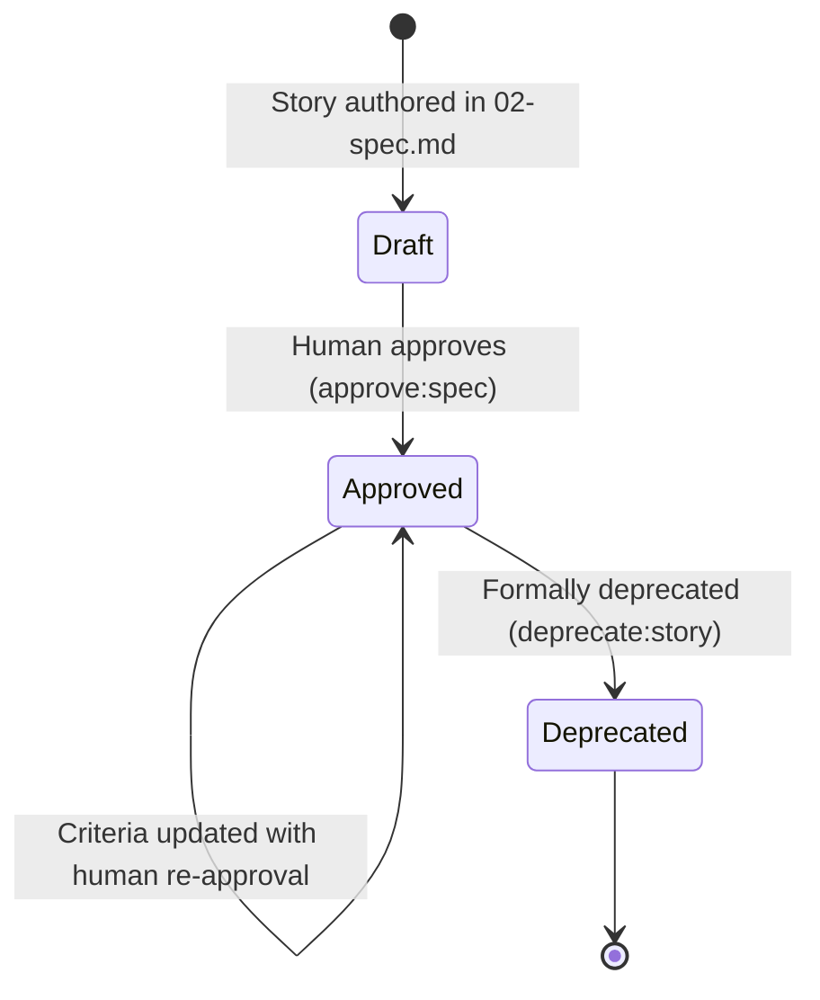

# Domain Model: AI Governance Platform

> **Governance Foundation Document 03:** Ubiquitous Language, Invariants, State Machine & Entities.

---

## 1. Domain Glossary

| Term | Ubiquitous Definition | Identifier in Code |
| :--- | :--- | :--- |
| **Policy** | Configurable rule-set declaring active profile, gate requirements, and failure modes. | `policy.json` / `Policy` |
| **Gate** | An isolated engineering verification check (e.g. `spec_integrity`, `test_suite`, `secrets`). | `GateResult` / `evaluateGate` |
| **Gate Status** | Structured evaluation outcome (`PASSED`, `FAILED`, `SKIPPED`, `NOT_CONFIGURED`, `REQUIRES_REVIEW`). | `GateStatus` |
| **Audit Block** | Cryptographically chained record capturing an action, author, attestation, and backward hash. | `AuditBlock` |
| **Head Anchor** | SHA-256 digest linking the latest audit block to external Git commit SHA and tree hash. | `state.headAnchor` |
| **Verdict** | Final signed compliance judgment issued for a pipeline run (`APPROVED`, `REJECTED`, `REQUIRES_REVIEW`). | `verdict.json` |
| **Agent Contract** | Machine-readable rule set defining protected paths and forbidden actions for AI agents. | `agent-contract.json` |

---

## 2. Invariants

| Invariant Rule | Enforcement Layer |
| :--- | :--- |
| Acceptance Criteria tables cannot be modified or deleted without explicit human approval (`approve:spec` or `deprecate:story`). | `scripts/state-guardian.mjs` (`verifyCriteriaIntegrity`) |
| The audit log hash chain must have unbroken backward continuity from genesis to head. | `scripts/state-guardian.mjs` (`verifyAuditChain`) |
| Skipped or unconfigured gates can NEVER display a `[PASS]` badge in evidence reports. | `scripts/verdict-engine.mjs` (`getGateBadge`) |
| Protected paths cannot be modified by autonomous AI agents. | `scripts/agent-control.mjs` (`isPathProtected`) |

---

## 3. Entity State Machine: Story Lifecycle

