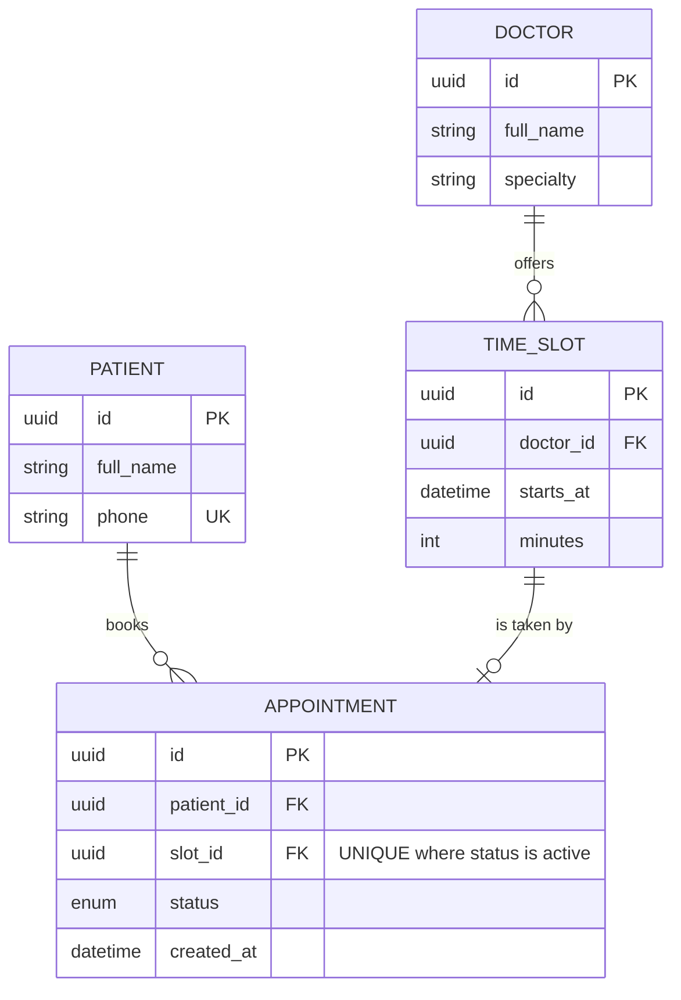
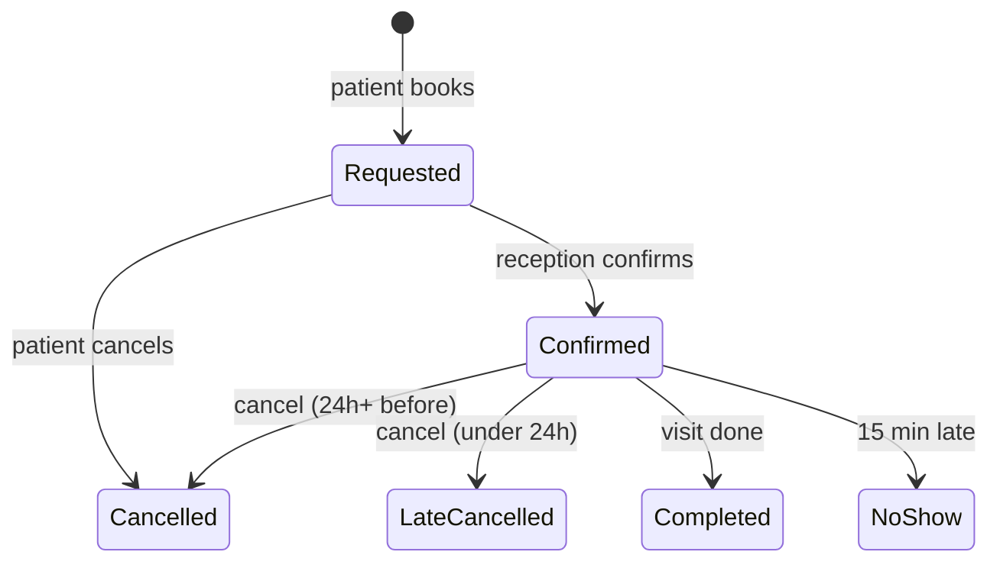
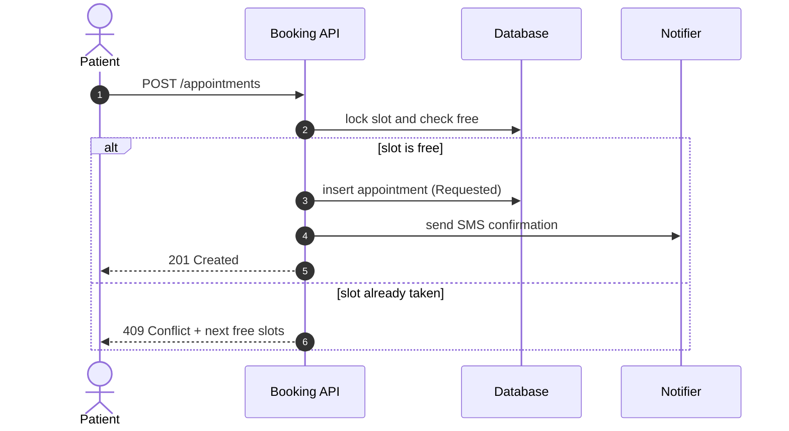

# Domain Model: Mawid (Clinic Booking)

> **Governance Foundation Document 03:** Domain Glossary, Entities, Invariants, FSM & Consistency Matrix.

---

## 1. Domain Glossary

| Domain Term           | Agreed Ubiquitous Definition                                                     | Identifier in Code |
| :-------------------- | :------------------------------------------------------------------------------- | :----------------- |
| **Time Slot**         | A scheduled block of clinic time offered by a doctor available for booking.      | `TimeSlot`         |
| **Appointment**       | A patient booking associated with a specific slot, governed by a state machine.  | `Appointment`      |
| **Confirmation**      | Receptionist approval and locking of a requested booking.                        | `confirm()`        |
| **Late Cancellation** | Cancellation of a confirmed appointment within less than 24 hours of start time. | `LateCancelled`    |
| **No-Show**           | Patient failure to arrive within 15 minutes after the scheduled start time.      | `NoShow`           |

---

## 2. Domain Invariants

| Invariant Rule                                                            | Enforcement Layer                                               |
| :------------------------------------------------------------------------ | :-------------------------------------------------------------- |
| Exactly one active appointment per time slot (Double-booking prohibited). | Database unique partial constraint + row-level lock on booking. |
| State transitions must strictly follow the arrows in the FSM diagram.     | Domain entity methods reject all illegal transitions.           |
| Doctors can view only their own appointments.                             | Authorization access policy layer + automated tests.            |

---

## 3. Entity-Relationship Diagram

---

## 4. Appointment Finite State Machine (FSM)

---

## 5. Booking Sequence Flow

---

## 6. Consistency Matrix (CRUD)

| Story                            | Patient | TimeSlot | Appointment |
| :------------------------------- | :------ | :------- | :---------- |
| **Story 1: View Slots**          | —       | Read     | Read        |
| **Story 2: Book Slot**           | Read    | Read     | Create      |
| **Story 3: Confirm Appointment** | Read    | —        | Update      |
| **Story 4: Cancel Appointment**  | —       | —        | Update      |
