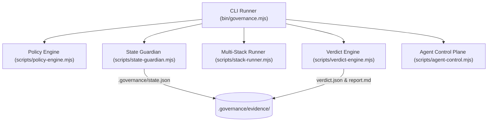

# Architecture: AI Governance Platform

> **Governance Foundation Document 04:** Architecture Drivers, Subsystem Boundaries & Topology.

---

## 1. Quality Attributes Driving Architectural Decisions

| Quality Attribute | Requirement Target | Architectural Implication |
| :--- | :--- | :--- |
| **Deterministic Integrity** | 100% tamper detection | SHA-256 backward hash chain with external Git tree & Notes anchoring. |
| **Multi-Stack Portability** | Zero binary dependencies | Pure ES Modules (Node.js built-ins: `crypto`, `child_process`, `fs`). |
| **Execution Performance** | Under 5 seconds locally | Lazy subprocess spawning, pre-flight executable checks, zero heavy dependencies. |
| **Truthful Evidence** | Zero false-positive passes | Strict 5-state gate taxonomy (`PASSED`, `FAILED`, `SKIPPED`, `NOT_CONFIGURED`, `REQUIRES_REVIEW`). |

---

## 2. Component Topology

---

## 3. Subsystem Responsibilities

| Subsystem | File | Core Responsibility |
| :--- | :--- | :--- |
| **Policy Engine** | `scripts/policy-engine.mjs` | Loads JSON policies, handles profiles (`strict`, `standard`, `lenient`), evaluates gate rules. |
| **State Guardian** | `scripts/state-guardian.mjs` | Locks criteria, manages story lifecycle, maintains SHA-256 audit hash chain, anchors Git notes. |
| **Stack Runner** | `scripts/stack-runner.mjs` | Discovers active language stacks (Node, PHP, Python, Java), executes tools, reports status. |
| **Verdict Engine** | `scripts/verdict-engine.mjs` | Generates signed `verdict.json`, truthful `report.md`, and requirements traceability matrices. |
| **Agent Control** | `scripts/agent-control.mjs` | Enforces protected path boundaries and verifies agent operating contracts. |
