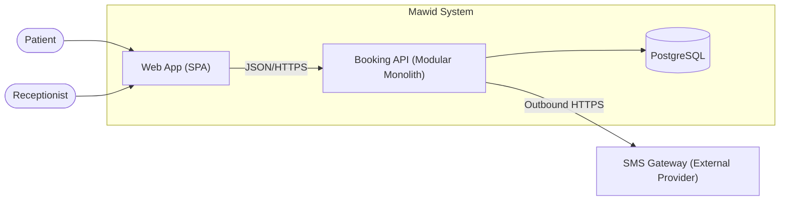

# Architecture: Mawid (Clinic Booking)

> **Governance Foundation Document 04:** Architecture Drivers, C4 Topology, and Module Boundaries.

---

## 1. Quality Attributes Driving Architectural Decisions

| Quality Attribute          | Requirement Target                | Architectural Implication                                                               |
| :------------------------- | :-------------------------------- | :-------------------------------------------------------------------------------------- |
| **Availability**           | NFR-2: 99.5% uptime               | Simple single-process deployment, daily automated backups, health check endpoints.      |
| **Privacy & Security**     | NFR-3: Access isolation           | Centralized authorization policy guard, structured audit logs for patient data access.  |
| **Operational Simplicity** | Small 2-person team & single host | Modular monolith architecture (single deployable unit with strict internal boundaries). |

---

## 2. Architecture Decisions

- **ADR-0001:** Adopt a Modular Monolith architecture to minimize distributed systems complexity.

---

## 3. System Context & Container Topology

---

## 4. Bounded Context Modules & Boundaries

| Module            | Core Responsibility                                                    | Public API Exposed                                                 |
| :---------------- | :--------------------------------------------------------------------- | :----------------------------------------------------------------- |
| **Scheduling**    | Doctors, schedules, and slot availability calculation.                 | `availableSlots(repo, doctorIds, from, to)`                        |
| **Booking**       | Appointments lifecycle, state machine, and race-condition resolution.  | `bookAppointment(deps, parcel)`, `cancelAppointment(deps, parcel)` |
| **Notifications** | External SMS delivery, retry policies, and offline contract isolation. | `smsNotifier(config).send(phone, message, idempotencyKey)`         |
