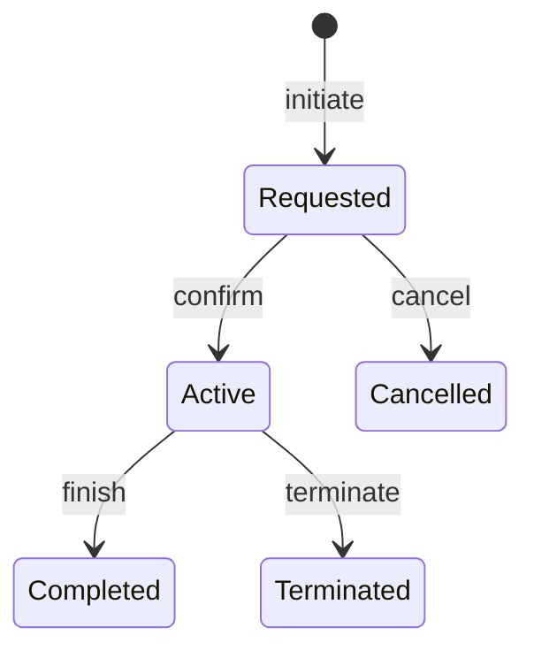
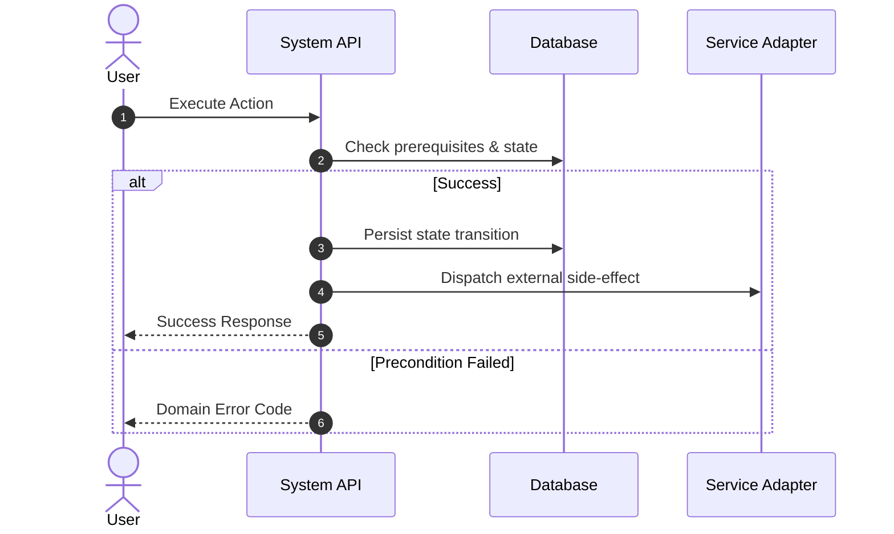

# Domain Model: {{PROJECT_TITLE}}

> **Governance Foundation Document 03:** Domain Glossary, Entities, Invariants, FSM & Consistency Matrix.

---

## 1. Domain Glossary

| Domain Term    | Agreed Ubiquitous Definition | Identifier in Code      |
| :------------- | :--------------------------- | :---------------------- |
| **{{TERM_1}}** | {{TERM_1_DEFINITION}}        | `{{TERM_1_IDENTIFIER}}` |
| **{{TERM_2}}** | {{TERM_2_DEFINITION}}        | `{{TERM_2_IDENTIFIER}}` |
| **{{TERM_3}}** | {{TERM_3_DEFINITION}}        | `{{TERM_3_IDENTIFIER}}` |

---

## 2. Domain Invariants

| Invariant Rule       | Enforcement Layer           |
| :------------------- | :-------------------------- |
| {{INVARIANT_1_RULE}} | {{INVARIANT_1_ENFORCEMENT}} |
| {{INVARIANT_2_RULE}} | {{INVARIANT_2_ENFORCEMENT}} |
| {{INVARIANT_3_RULE}} | {{INVARIANT_3_ENFORCEMENT}} |

---

## 3. Entity-Relationship Diagram

```mermaid
erDiagram
  {{ENTITY_1}} ||--o{ {{ENTITY_2}} : has
  {{ENTITY_1}} {
    uuid id PK
    string name
    datetime created_at
  }
  {{ENTITY_2}} {
    uuid id PK
    uuid entity_1_id FK
    string status
  }
```

---

## 4. Finite State Machine (FSM)



---

## 5. Sequence Flow



---

## 6. Consistency Matrix (CRUD)

| Story                          | {{ENTITY_1}} | {{ENTITY_2}} |
| :----------------------------- | :----------- | :----------- |
| **Story 1: {{STORY_1_TITLE}}** | Read         | Read         |
| **Story 2: {{STORY_2_TITLE}}** | Read         | Create       |
| **Story 3: {{STORY_3_TITLE}}** | Read         | Update       |
