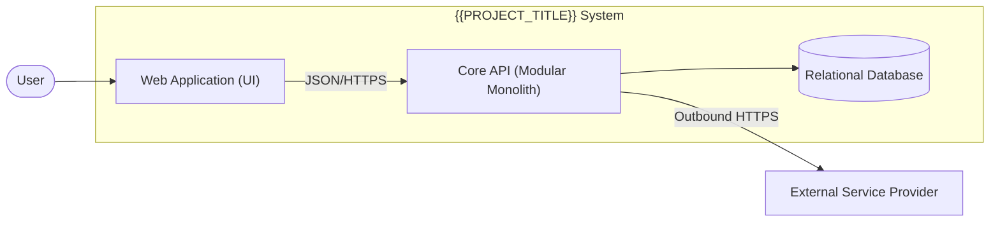

# Architecture: {{PROJECT_TITLE}}

> **Governance Foundation Document 04:** Architecture Drivers, C4 Topology, and Module Boundaries.

---

## 1. Quality Attributes Driving Architectural Decisions

| Quality Attribute          | Requirement Target      | Architectural Implication    |
| :------------------------- | :---------------------- | :--------------------------- |
| **Availability**           | {{AVAILABILITY_TARGET}} | {{AVAILABILITY_IMPLICATION}} |
| **Privacy & Security**     | {{SECURITY_TARGET}}     | {{SECURITY_IMPLICATION}}     |
| **Operational Simplicity** | {{SIMPLICITY_TARGET}}   | {{SIMPLICITY_IMPLICATION}}   |

---

## 2. Architecture Decisions

- **ADR-0001:** {{PRIMARY_ARCHITECTURE_DECISION}}

---

## 3. System Context & Container Topology

---

## 4. Bounded Context Modules & Boundaries

| Module                | Core Responsibility         | Public API Exposed        |
| :-------------------- | :-------------------------- | :------------------------ |
| **{{MODULE_1_NAME}}** | {{MODULE_1_RESPONSIBILITY}} | `{{MODULE_1_PUBLIC_API}}` |
| **{{MODULE_2_NAME}}** | {{MODULE_2_RESPONSIBILITY}} | `{{MODULE_2_PUBLIC_API}}` |
| **{{MODULE_3_NAME}}** | {{MODULE_3_RESPONSIBILITY}} | `{{MODULE_3_PUBLIC_API}}` |
