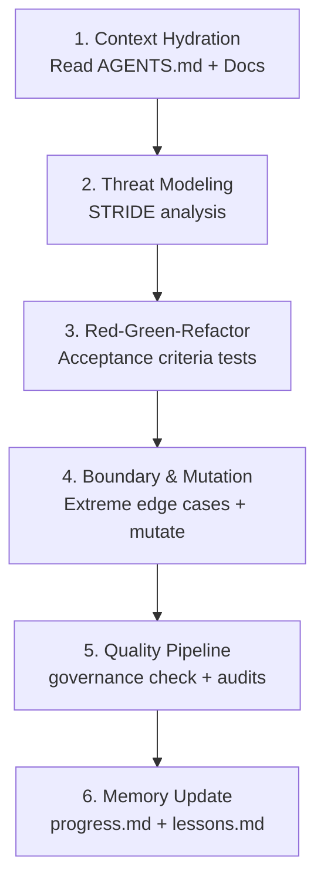

# Agent Execution Lifecycle & Operational Protocol

> **Governance Standards Document:** The step-by-step protocol for AI agents implementing features, fixes, or refactorings.

---

## 1. The 6-Stage Operational Protocol

Whenever an AI agent is assigned a task, it must proceed through the following six stages sequentially without skipping:



---

### Stage 1: Context Hydration (Stable First, Changing Last)

Before touching any code or making assumptions, the agent must hydrate its working memory in the canonical order:

1. `AGENTS.md` (Constitutional rules and constraints).
2. `docs/index.md` (Architecture map).
3. `docs/foundation/03-domain.md` (Glossary and invariants).
4. `docs/foundation/02-spec.md` (Target story acceptance criteria).
5. `docs/lifecycle/progress.md` (Current state and recent decisions).

---

### Stage 2: Threat Modeling (Pre-Implementation STRIDE)

Before writing production implementation code, the agent must:

1. Create or update the one-page threat model under `docs/lifecycle/threat-model/story-<n>.md`.
2. Analyze the six STRIDE vectors: Spoofing, Tampering, Repudiation, Information Disclosure, Denial of Service, Elevation of Privilege.
3. Identify all concrete controls and corresponding tests required.

---

### Stage 3: Red-Green-Refactor Cycle

1. **Red (Failing Test First):** Write an acceptance test named `ac_<story>_<n>` expressing the Gherkin criteria from the spec. Run the test and confirm it fails for the expected reason.
2. **Green (Minimal Domain Logic):** Implement the cleanest minimal domain code required to turn the test green.
3. **Refactor:** Clean up code, remove duplication, and clarify variable names while keeping tests passing.

---

### Stage 4: Boundary & Mutation Hardening

1. **Limit Checks:** Test exact boundary numbers (e.g., exact boundary limits, zero, empty collection, max length).
2. **Idempotency:** Test that repeating mutating actions produces consistent, safe results without duplicate records.
3. **Mutation Testing:** Run `npm run mutate` (or `node ./bin/governance.mjs mutate`). Verify zero surviving mutants in core domain invariants.

---

### Stage 5: Full Automated Pipeline Pass

The agent must execute the complete verification pipeline locally:

```bash
node ./bin/governance.mjs check
node ./bin/governance.mjs audit:git
node ./bin/governance.mjs audit:design
```

All checks must exit with code `0`. Zero lint errors, zero type errors, 100% test pass rate.

---

### Stage 6: Memory Update & Completion Proof

1. Update `docs/lifecycle/progress.md` with completed items and next steps.
2. If an architectural discovery or immutable lesson was learned, add a 3-part row to `docs/lifecycle/lessons.md`.
3. Present the completion report to the user including test counts, verification commands executed, and exact diff summary.

---

## 2. Hard Agent Stop Conditions

The agent must immediately STOP and request human user clarification when:

1. **Contradictory Requirements:** The user request contradicts a written invariant in `03-domain.md` or `02-spec.md`.
2. **New Dependencies:** A new third-party package is needed that is not already approved in `docs/standards/dependencies.md`.
3. **Breaking Schema Changes:** A database migration or contract alteration would break existing deployed consumers.
4. **Failing Existing Tests:** Existing tests fail unexpectedly outside the immediate scope of the current task.
