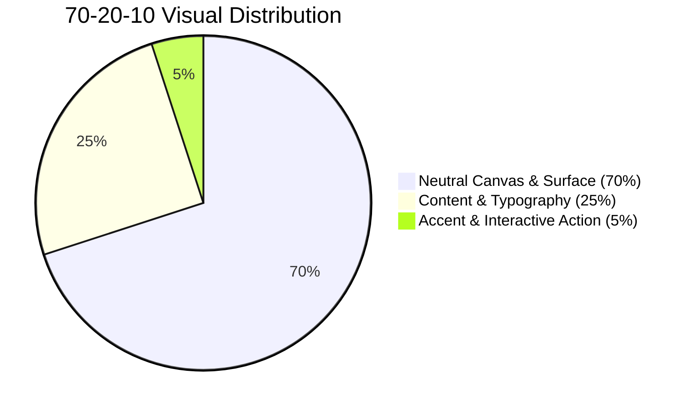

# Design System & Visual Standards

> **Governance Standards Document:** Rules for semantic color tokens, palette roles, typography, spacing, and bidirectional layout.

---

## 1. The 70-20-10 Color Architecture

Color usage in the interface is strictly governed by the 70-20-10 distribution rule to ensure visual calm, strong hierarchy, and high legibility:



| Palette Role             | Ratio   | Semantic Purpose                                                    | Token Name                                                                   | Rules & Invariants                                                                          |
| :----------------------- | :------ | :------------------------------------------------------------------ | :--------------------------------------------------------------------------- | :------------------------------------------------------------------------------------------ |
| **Neutral / Canvas**     | **70%** | Page backgrounds, card containers, dialog backdrops, panel surfaces | `--color-canvas`<br/>`--color-surface`<br/>`--color-surface-subtle`          | Provides high contrast, visual breathing room, and low eye fatigue. Dominates the viewport. |
| **Content / Structure**  | **25%** | Primary headlines, body prose, structural dividers, icon outlines   | `--color-ink`<br/>`--color-graphite`<br/>`--color-border`                    | Ensures clear typography, sharp readability, and distinct content boundaries.               |
| **Accent / Interactive** | **5%**  | Primary action buttons, active states, key data highlights, badges  | `--color-accent`<br/>`--color-accent-subtle`<br/>`--color-accent-foreground` | Reserved for user attention and primary calls-to-action.                                    |

### The Golden Accent Invariant

> **Rule:** The Accent color is an interactive accent, NEVER a canvas background.
>
> Solid, full-screen canvas backgrounds filled with the accent color (or vibrant primary brand colors) cause severe eye fatigue and destroy visual hierarchy. The accent color may be applied only to interactive elements, indicator pills, focus rings, and compact callout badges.

---

## 2. Semantic Color Tokens

Colors must always be referenced through CSS semantic tokens rather than hardcoded raw hex values:

```css
:root {
  /* Neutral Canvas & Surfaces (70%) */
  --color-canvas: {{CANVAS_COLOR_HEX}};
  --color-surface: {{SURFACE_COLOR_HEX}};
  --color-surface-subtle: {{SURFACE_SUBTLE_HEX}};

  /* Content & Structure (25%) */
  --color-ink: {{INK_COLOR_HEX}};
  --color-graphite: {{GRAPHITE_COLOR_HEX}};
  --color-border: {{BORDER_COLOR_HEX}};

  /* Accent & Interactive Focus (5%) */
  --color-accent: {{ACCENT_COLOR_HEX}}; /* Primary brand accent */
  --color-accent-subtle: {{ACCENT_SUBTLE_HEX}};
  --color-accent-foreground: {{ACCENT_FOREGROUND_HEX}};

  /* Feedback & Alerts */
  --color-danger: {{DANGER_COLOR_HEX}};
  --color-warning: {{WARNING_COLOR_HEX}};
  --color-success: {{SUCCESS_COLOR_HEX}};
}
```

---

## 3. Typography Hierarchy

Typography must harmonize bilingual interfaces across all weights and sizes:

```css
font-family:
  {{PRIMARY_FONT_FAMILY}},
  ui-sans-serif,
  system-ui,
  -apple-system,
  sans-serif;
```

### Typographical Rules

1. **Explicit Line Heights:** Always pair font size with appropriate line-height (`font-size: 1rem; line-height: 1.5;`) to avoid glyph clipping in complex scripts.
2. **Tabular Figures for Data:** Numerical data, dates, and currency values must use monospace or tabular numbers (`font-variant-numeric: tabular-nums`) to prevent jitter in tables and timers.
3. **Hierarchy Contrast:** Headlines must be distinguished by weight and size, not by decorative coloring.

---

## 4. Spacing & Bidirectional (RTL / LTR) Layout

All layouts must use standard fluid spacing tokens and CSS Logical Properties to guarantee seamless bidirectional rendering:

### Mandatory CSS Logical Properties

| Forbidden Physical Property      | Mandatory Logical Property                   |
| :------------------------------- | :------------------------------------------- |
| `margin-left`, `margin-right`    | `margin-inline-start`, `margin-inline-end`   |
| `padding-left`, `padding-right`  | `padding-inline-start`, `padding-inline-end` |
| `left`, `right` (in positioning) | `inset-inline-start`, `inset-inline-end`     |
| `border-left`, `border-right`    | `border-inline-start`, `border-inline-end`   |
| `text-align: left`               | `text-align: start`                          |
| `text-align: right`              | `text-align: end`                            |

---

## 5. Automated Verification (`governance audit:design`)

The design system scanner validates the following invariants:

- Zero occurrences of accent color applied as container or canvas background.
- Zero hardcoded hex colors inside component markup.
- Zero physical directional CSS rules (`margin-left`, `padding-right`) in directional containers.
